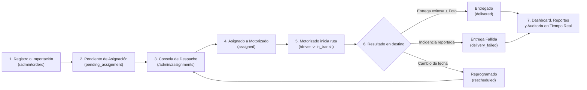

# Delivery Fleet Manager (DFM)

Plataforma SaaS multi-empresa para la gestión logística, despacho de pedidos y administración de flotas de motorizados en tiempo real. Configurada inicialmente para operaciones en **Perú** (`America/Lima`, moneda `PEN S/`, prefijo `+51`), con arquitectura preparada para múltiples organizaciones, países y zonas horarias.

---

## Tabla de Contenidos

1. [Stack Tecnológico](#1-stack-tecnológico)
2. [Estructura del Proyecto](#2-estructura-del-proyecto)
3. [Arquitectura de Autenticación, Roles (RBAC) y Seguridad (RLS)](#3-arquitectura-de-autenticación-roles-rbac-y-seguridad-rls)
4. [Flujo Operativo Completo del Sistema](#4-flujo-operativo-completo-del-sistema)
5. [Guía de Administración: Cómo Agregar Empresas, Usuarios y Motorizados](#5-guía-de-administración-cómo-agregar-empresas-usuarios-y-motorizados)
   - [5.1. Cómo agregar una nueva Empresa (Organización)](#51-cómo-agregar-una-nueva-empresa-organización)
   - [5.2. Cómo agregar Usuarios (Super Admin, Admin, Supervisor)](#52-cómo-agregar-usuarios-super-admin-admin-supervisor)
   - [5.3. Cómo agregar Motorizados y darles acceso a la App Móvil](#53-cómo-agregar-motorizados-y-darles-acceso-a-la-app-móvil)
6. [Importación Masiva de Pedidos (CSV / Excel)](#6-importación-masiva-de-pedidos-csv--excel)
7. [Instalación y Ejecución Local](#7-instalación-y-ejecución-local)

---

## 1. Stack Tecnológico

- **Frontend:** Next.js 16 (App Router), React 19, TypeScript (Strict Mode), Tailwind CSS v4, shadcn/ui (Base UI + Radix Primitives), Lucide React.
- **Formularios y Validaciones:** React Hook Form + Zod.
- **Visualización de Datos y Tablas:** Recharts (gráficos estadísticos), tablas con ordenamiento, filtros multicriterio, paginación y acciones por lote.
- **Procesamiento de Archivos:** PapaParse (`.csv` con detección automática `UTF-8` / `Windows-1252`) y SheetJS `xlsx` (`.xlsx` / `.xls`).
- **Backend & Base de Datos:** Supabase
  - **PostgreSQL:** 16 tablas relacionales, 7 tipos `ENUM`, triggers automáticos y funciones `SECURITY DEFINER`.
  - **Supabase Auth:** Autenticación centralizada con JWT en cookies HTTP-only (`@supabase/ssr`).
  - **Row Level Security (RLS):** Aislamiento estricto por empresa (`organization_id`) y por motorizado (`assigned_driver_id`).
  - **Supabase Storage:** Bucket `delivery-evidence` para fotografías de entrega, paquetes, fachadas e incidencias.
  - **Supabase Realtime:** Sincronización instantánea entre la consola de despacho y la pantalla móvil del motorizado.

---

## 2. Estructura del Proyecto

```text
DELIVERY_SYSTEM/
├── supabase/
│   └── migrations/
│       ├── 001_initial_schema.sql      # Esquema completo: 16 tablas, enums, triggers, RLS, Storage y Realtime
│       ├── 002_seed_data.sql           # Datos semilla de demostración (FleetDemo Peru, 5 motorizados, 30 pedidos)
│       └── 003_link_test_users.sql     # Script para vincular cuentas de Auth con perfiles y motorizados
│
└── delivery-fleet-manager/             # Aplicación Next.js (App Router)
    ├── public/
    │   └── manifest.json               # Manifiesto PWA para instalación en celulares de motorizados
    ├── src/
    │   ├── middleware.ts               # Guardián de rutas Next.js (refresco de sesión y bloqueo RBAC por URL)
    │   ├── app/
    │   │   ├── layout.tsx              # Layout raíz (fuente Inter, metadatos PWA y Toaster global)
    │   │   ├── page.tsx                # Redirección inteligente según sesión y rol
    │   │   ├── login/
    │   │   │   └── page.tsx            # Inicio de sesión con validación Zod y redirección por rol
    │   │   ├── admin/                  # ÁREA ADMINISTRATIVA (super_admin, admin, supervisor)
    │   │   │   ├── layout.tsx          # Verificación de rol en servidor + Sidebar + Header
    │   │   │   ├── dashboard/page.tsx  # KPIs del día, tasa de éxito, gráficos Recharts y actividad reciente
    │   │   │   ├── orders/page.tsx     # Gestión de pedidos, filtros, acciones masivas y exportación CSV
    │   │   │   ├── assignments/page.tsx# Consola dividida de despacho y asignación en tiempo real
    │   │   │   ├── drivers/page.tsx    # Gestión de flota de motorizados, métricas y soft-delete
    │   │   │   ├── reports/page.tsx    # Reportes de productividad por fechas, motivos de fallo y exportación
    │   │   │   └── settings/page.tsx   # Plantillas WhatsApp, gestión de roles RBAC y logs de auditoría
    │   │   └── driver/                 # APLICACIÓN MÓVIL DEL MOTORIZADO (driver)
    │   │       ├── layout.tsx          # Layout móvil con cabecera compacta y navegación inferior táctil
    │   │       ├── page.tsx            # Hoja de ruta en vivo, filtros y preparador masivo de WhatsApp
    │   │       ├── history/page.tsx    # Historial de entregas completadas e incidencias del repartidor
    │   │       └── profile/page.tsx    # Cambio rápido de disponibilidad e indicadores personales
    │   ├── components/
    │   │   ├── dashboard/              # Gráficos (dashboard-charts.tsx) y pedidos recientes (recent-orders.tsx)
    │   │   ├── delivery/               # Tarjeta móvil (driver-order-card.tsx), modal de estados y subida de fotos
    │   │   ├── layout/                 # Sidebars, headers y barra inferior móvil
    │   │   ├── orders/                 # Formulario de pedido, importador CSV/Excel panorámico y panel de detalle
    │   │   └── ui/                     # Componentes base de interfaz (shadcn/ui)
    │   ├── lib/
    │   │   ├── constants/index.ts      # Distritos de Lima, colores de estado, motivos de incidencia y menús
    │   │   ├── permissions/index.ts    # Matriz centralizada de permisos RBAC y rutas por defecto
    │   │   ├── supabase/               # Clientes tipados de Supabase (client.ts, server.ts, middleware.ts)
    │   │   └── utils/                  # Formateo de fechas (date-fns es), moneda PEN, URLs de WhatsApp y Maps
    │   ├── services/
    │   │   └── whatsapp/index.ts       # Servicio de preparación individual/masiva de WhatsApp con interpolación
    │   └── types/
    │       └── database.ts             # Tipado estricto de las 16 tablas de Supabase y máquina de estados
    └── .env.local                      # Variables de entorno locales (URL y Anon Key de Supabase)
```

---

## 3. Arquitectura de Autenticación, Roles (RBAC) y Seguridad (RLS)

### 3.1. Flujo de Autenticación
1. El usuario ingresa su correo y contraseña en `/login`.
2. Supabase Auth valida las credenciales y emite un token JWT almacenado en cookies seguras mediante `@supabase/ssr`.
3. Al crearse un usuario en `auth.users`, el trigger de base de datos `on_auth_user_created` ejecuta automáticamente la función `public.handle_new_user()`, creando su registro correspondiente en la tabla `public.profiles`.
4. El middleware ([`src/lib/supabase/middleware.ts`](file:///c:/Users/curva/OneDrive/Desktop/DELIVERY_SYSTEM/delivery-fleet-manager/src/lib/supabase/middleware.ts)) intercepta cada petición:
   - Si no hay sesión activa y la ruta no es `/login`, redirige a `/login`.
   - Si el usuario ya inició sesión, consulta su rol en `public.profiles` y lo redirige a su área correspondiente:
     - `super_admin` y `admin` → `/admin/dashboard`
     - `supervisor` → `/admin/operations` (consola de despacho `/admin/assignments`)
     - `driver` → `/driver`
   - **Bloqueo estricto:** Si un usuario con rol `driver` intenta escribir manualmente cualquier URL bajo `/admin/*`, el middleware y el layout del servidor lo redirigen de inmediato a `/driver`.

### 3.2. Roles del Sistema (RBAC)

| Rol | Alcance y Permisos Principales |
|-----|-------------------------------|
| **`super_admin`** | Control total de la organización: gestión de usuarios y cambio de roles, creación/baja de motorizados, pedidos, asignaciones, plantillas de WhatsApp, reportes y auditoría completa. |
| **`admin`** | Gestión operativa completa: crear/importar/editar/cancelar pedidos, asignar motorizados, gestionar flota de motorizados, plantillas de WhatsApp, reportes y auditoría. |
| **`supervisor`** | Supervisión y despacho: consultar dashboard, asignar y reasignar pedidos a motorizados, supervisar entregas en tiempo real, gestionar incidencias y consultar reportes. |
| **`driver`** | Acceso exclusivo a la interfaz móvil `/driver`: ver únicamente sus propios pedidos asignados, contactar clientes por llamada/WhatsApp, abrir navegación en Google Maps, subir evidencias fotográficas y actualizar estados autorizados (*En camino*, *Entregado*, *Pendiente*, *Entrega fallida*, *Reprogramado*). |

### 3.3. Seguridad en Base de Datos (Row Level Security)
Incluso si alguien intentara consultar la API de Supabase directamente desde el navegador, PostgreSQL protege cada fila mediante funciones `SECURITY DEFINER`:
- `public.get_my_org_id()`: Garantiza que ningún usuario pueda ver ni modificar datos de otra empresa.
- `public.get_my_role()`: Verifica el rol real del usuario en el servidor de base de datos.
- `public.get_my_driver_id()`: Devuelve el `drivers.id` vinculado al `auth.uid()` actual. La política RLS `orders_select_driver` exige `assigned_driver_id = public.get_my_driver_id()`, haciendo imposible que un motorizado vea pedidos de otro repartidor.

---

## 4. Flujo Operativo Completo del Sistema



1. **Ingreso de Pedidos (`/admin/orders`):**
   - El administrador registra pedidos individualmente o sube un archivo **CSV / Excel** en el importador panorámico.
   - Todo pedido nuevo sin motorizado nace en estado **`Pendiente de asignación`** (`pending_assignment`).
2. **Despacho y Asignación (`/admin/assignments`):**
   - En el panel izquierdo aparecen todos los pedidos pendientes filtrables por distrito o búsqueda.
   - En el panel derecho aparecen los motorizados activos con su disponibilidad (`Disponible`, `Ocupado`) y cuántos pedidos tienen actualmente en ruta.
   - El supervisor selecciona uno o varios pedidos, elige al motorizado y confirma la asignación. El pedido pasa a **`Asignado`** (`assigned`), se registra en `order_assignments`, en `order_status_history`, en `audit_logs` y se notifica por **Realtime** al celular del motorizado.
3. **Preparación de Ruta y Contacto por WhatsApp (`/driver`):**
   - El motorizado ve sus pedidos del día en su celular.
   - Puede seleccionar múltiples pedidos y pulsar **"Preparar WhatsApp"** para abrir los chats prellenados con el nombre del cliente, código de pedido y dirección, o tocar el botón individual de **WhatsApp**, **Llamar** o **Mapa** (que abre la ruta exacta en Google Maps).
   - Al salir hacia el punto, cambia el estado a **`En camino`** (`in_transit`).
4. **Entrega, Evidencia o Incidencia (`/driver`):**
   - Al llegar, el motorizado toca **"Subir foto"** para capturar con la cámara la foto de la entrega o de la fachada (se almacena en Supabase Storage `delivery-evidence`).
   - Luego toca **"Cambiar estado"**:
     - Si entregó el paquete: marca **`Entregado`** (`delivered`).
     - Si no pudo entregar: marca **`Entrega fallida`** (`delivery_failed`) y selecciona el motivo obligatorio (*Cliente ausente*, *No responde*, *Dirección incorrecta*, *Rechazó el pedido*, etc.), creando un registro en `delivery_incidents`.
     - Si el cliente pide recibirlo otro día: marca **`Reprogramado`** (`rescheduled`), elige la nueva fecha y el motivo, registrándose en `order_reschedules`.
5. **Supervisión y Reportes (`/admin/dashboard` y `/admin/reports`):**
   - El administrador ve en tiempo real cómo suben los indicadores de entregas exitosas, consulta las fotos subidas en el panel lateral de detalle del pedido y exporta los reportes de productividad por motorizado en CSV.

---

## 5. Guía de Administración: Cómo Agregar Empresas, Usuarios y Motorizados

### 5.1. Cómo agregar una nueva Empresa (Organización)

Cada empresa dentro de la plataforma está representada por un registro en `public.organizations` y su configuración en `public.organization_settings`. Para dar de alta una nueva empresa, ejecuta en el **SQL Editor** de Supabase:

```sql
-- 1. Crear la organización
INSERT INTO public.organizations (
  id, name, slug, country_code, currency_code, phone_prefix, timezone
) VALUES (
  'a0000000-0000-0000-0000-000000000002'::UUID,
  'Mi Empresa Express SAC',
  'mi-empresa-express',
  'PE', 'PEN', '+51', 'America/Lima'
);

-- 2. Crear su configuración inicial
INSERT INTO public.organization_settings (
  organization_id,
  company_name,
  default_timezone,
  default_currency,
  default_country,
  default_phone_prefix
) VALUES (
  'a0000000-0000-0000-0000-000000000002'::UUID,
  'Mi Empresa Express SAC',
  'America/Lima',
  'PEN',
  'PE',
  '+51'
);
```

---

### 5.2. Cómo agregar Usuarios (`super_admin`, `admin`, `supervisor`)

1. Ve a tu panel de Supabase → **Authentication → Users → Add user → Create new user**.
2. Ingresa el **Email** y **Password** del usuario y marca **"Auto Confirm User"**.
   *(El trigger `handle_new_user` creará automáticamente su fila en `public.profiles`)*.
3. Vincula ese usuario a tu empresa y asígnale su rol ejecutando este bloque en el **SQL Editor** (reemplazando el correo y el rol deseado: `'super_admin'`, `'admin'` o `'supervisor'`):

```sql
DO $$
DECLARE
  v_org_id UUID := 'a0000000-0000-0000-0000-000000000001'; -- ID de tu empresa
  v_user_id UUID;
BEGIN
  SELECT id INTO v_user_id FROM auth.users WHERE email = 'nuevo.admin@empresa.com' LIMIT 1;

  IF v_user_id IS NOT NULL THEN
    -- Actualizar perfil con nombre, organización y rol
    UPDATE public.profiles
    SET
      organization_id = v_org_id,
      full_name = 'Nombre del Administrador',
      role = 'admin', -- Opciones: 'super_admin', 'admin', 'supervisor'
      is_active = TRUE
    WHERE id = v_user_id;

    -- Registrar membresía en la organización
    INSERT INTO public.organization_members (organization_id, user_id, role, is_active)
    VALUES (v_org_id, v_user_id, 'admin', TRUE)
    ON CONFLICT (organization_id, user_id) DO UPDATE SET role = 'admin';
  END IF;
END $$;
```

> **Nota:** Una vez que los usuarios pertenecen a la misma organización, cualquier `super_admin` puede cambiarles el rol directamente desde la interfaz web en **`/admin/settings` → pestaña "Usuarios y Roles (RBAC)"**.

---

### 5.3. Cómo agregar Motorizados y darles acceso a la App Móvil

Existen dos formas de gestionar un motorizado:

#### Paso A: Registrar la ficha operativa del motorizado (Desde la Web)
1. Inicia sesión como Administrador y entra a **`/admin/drivers` (Motorizados)**.
2. Haz clic en **"Registrar motorizado"** y completa:
   - **Nombre completo** (ej. *Miguel Ángel Soto*)
   - **DNI / CE**
   - **Teléfono celular** y **WhatsApp**
   - **Correo electrónico** (ej. `miguel.soto@empresa.com`)
   - **Estado operativo** (`Disponible`) y **Notas / Placa de moto**.
3. Al guardar, el motorizado ya aparece inmediatamente en **`/admin/assignments`** y se le pueden asignar pedidos.

#### Paso B: Darle usuario y contraseña para que entre a `/driver` desde su celular
Si deseas que ese motorizado inicie sesión desde su celular en la app móvil (`/driver`):
1. En Supabase, ve a **Authentication → Users → Add user → Create new user** y crea su cuenta con el mismo correo (ej. `miguel.soto@empresa.com`) y su contraseña, marcando **"Auto Confirm User"**.
2. En el **SQL Editor** de Supabase, ejecuta este script para enlazar su usuario de login con su ficha de motorizado:

```sql
DO $$
DECLARE
  v_org_id UUID := 'a0000000-0000-0000-0000-000000000001';
  v_driver_email TEXT := 'miguel.soto@empresa.com';
  v_user_id UUID;
BEGIN
  SELECT id INTO v_user_id FROM auth.users WHERE email = v_driver_email LIMIT 1;

  IF v_user_id IS NOT NULL THEN
    -- 1. Configurar su perfil con rol 'driver'
    UPDATE public.profiles
    SET
      organization_id = v_org_id,
      role = 'driver',
      is_active = TRUE
    WHERE id = v_user_id;

    -- 2. Registrar en organization_members
    INSERT INTO public.organization_members (organization_id, user_id, role, is_active)
    VALUES (v_org_id, v_user_id, 'driver', TRUE)
    ON CONFLICT (organization_id, user_id) DO UPDATE SET role = 'driver';

    -- 3. Vincular el user_id en la tabla drivers usando su correo
    UPDATE public.drivers
    SET user_id = v_user_id
    WHERE organization_id = v_org_id
      AND LOWER(email) = LOWER(v_driver_email)
      AND deleted_at IS NULL;
  END IF;
END $$;
```

A partir de ese momento, cuando el motorizado inicie sesión en `/login`, será llevado directamente a `/driver` y verá en tiempo real todos los pedidos asignados a su ficha.

---

## 6. Importación Masiva de Pedidos (CSV / Excel)

En **`/admin/orders` → botón "Importar CSV/Excel"**, el sistema cuenta con un validador panorámico interactivo:

- **Columnas reconocidas automáticamente:**
  - `codigo` (opcional, detecta duplicados contra la base de datos y dentro del mismo archivo)
  - `cliente` *(obligatorio)*
  - `telefono` *(obligatorio)*
  - `distrito` *(obligatorio, convierte automáticamente abreviaturas como `SJL` → `San Juan de Lurigancho`, `SJM` → `San Juan de Miraflores`, `SMP` → `San Martín de Porres`, `VES` → `Villa El Salvador`, `VMT` → `Villa María del Triunfo`, `SURCO` → `Santiago de Surco`, etc.)*
  - `direccion` *(opcional: permite dejarse vacío cuando se coordina ubicación por WhatsApp)*
  - `referencia` *(opcional)*
  - `fecha` *(acepta formatos `18/11/2026`, `18-11-2026`, `2026-11-18` o fechas seriales de Excel)*
  - `importe` / `monto` *(opcional, acepta `45.50`, `45,50` o `S/ 45.50`)*
  - `observaciones` *(opcional, ej. `PEDIR UBICACIÓN`)*
- **Edición en vivo durante la validación:** Antes de confirmar la importación, puedes modificar manualmente en la tabla el **Distrito**, **Dirección**, **Monto S/**, **Fecha**, **Observación**, **Teléfono** o **Código**, y cada fila se revalida en tiempo real.
- **Descarte de filas:** Puedes descartar cualquier fila con el botón de papelera individual o usar el botón **"Descartar todas las rechazadas"** para limpiar de un clic las filas con error.

---

## 7. Instalación y Ejecución Local

1. Configurar las variables en [`delivery-fleet-manager/.env.local`](file:///c:/Users/curva/OneDrive/Desktop/DELIVERY_SYSTEM/delivery-fleet-manager/.env.local):
   ```env
   NEXT_PUBLIC_SUPABASE_URL=https://tu-proyecto.supabase.co
   NEXT_PUBLIC_SUPABASE_ANON_KEY=tu-anon-key
   NEXT_PUBLIC_APP_URL=http://localhost:3000
   NEXT_PUBLIC_APP_NAME="Delivery Fleet Manager"
   ```
2. Instalar dependencias e iniciar el servidor de desarrollo:
   ```powershell
   cd delivery-fleet-manager
   npm install
   npm run dev
   ```
3. Abrir `http://localhost:3000` en el navegador.
